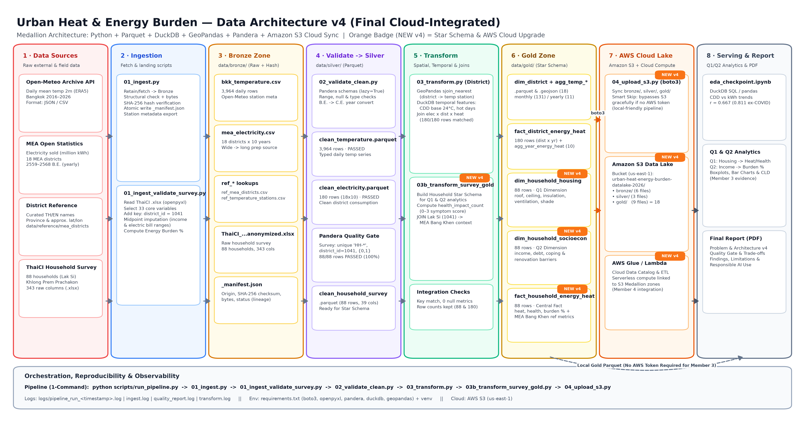

# Urban Heat & Energy Burden (CS341 Term Project)

ระบบ Data Pipeline แบบอัตโนมัติ (Medallion Architecture: Local-first + AWS Cloud) สำหรับวิเคราะห์ความสัมพันธ์ระหว่างความร้อนในเมือง ลักษณะทางกายภาพของที่อยู่อาศัย และภาระค่าใช้จ่ายด้านพลังงานของครัวเรือนในกรุงเทพมหานคร (Final Version)

## สถาปัตยกรรมระบบ (Data Architecture v4)


## โครงสร้างโฟลเดอร์ (Project Structure)
* `data/bronze/` : ข้อมูลดิบ (Raw Data) จาก Open-Meteo API, การไฟฟ้านครหลวง (MEA) และแบบสำรวจครัวเรือนโครงการ ThaiCI (88 ครัวเรือน เขตหลักสี่) พร้อม `_manifest.json` (lineage + SHA-256)
* `data/silver/` : ข้อมูลที่ผ่านการทำความสะอาดและ Pandera Quality Gate ในรูปแบบ Apache Parquet
* `data/gold/` : ตารางวิเคราะห์ (Star Schema) ระดับเขตและระดับครัวเรือน
* `scripts/` : สคริปต์ Python ของ Pipeline ทั้งหมด (01 → 06)
* `cloud/` : โค้ดฝั่ง AWS — `lambda/lake_organizer/` (AWS Lambda) และ `athena/*.sql` (Amazon Athena queries)
* `docs/` : แผนภาพสถาปัตยกรรม, พจนานุกรมข้อมูล (`ThaiCI_Household_Questionaire.docx`), ผลวิเคราะห์ Role 3 (`role3_deliverables/`) และหลักฐานจาก Cloud (`cloud_evidence/`)
* `notebooks/` : Jupyter Notebook สำหรับ EDA และกราฟสรุปผล Q1–Q2
* `requirements.txt` : Library ที่ต้องใช้ (`requirements-spark.txt` = เพิ่ม PySpark สำหรับ `demo_checkpoint.ipynb` เท่านั้น)

## วิธีการติดตั้ง (Installation)
ต้องมี **Python 3.11–3.13** (ทดสอบบน Python 3.12, macOS Intel และ Windows)

1. **Clone Repository**
   ```bash
   git clone https://github.com/chaloemwong109-lab/urban-heat-energy-burden.git
   cd urban-heat-energy-burden
   ```

2. **สร้างและเปิดใช้งาน Virtual Environment**
   * **Windows:**
     ```bash
     python -m venv venv
     venv\Scripts\activate
     ```
   * **Mac / Linux:**
     ```bash
     python3 -m venv venv
     source venv/bin/activate
     ```

3. **ติดตั้ง Library**
   ```bash
   pip install -r requirements.txt
   ```
   * ถ้าจะรัน `demo_checkpoint.ipynb` (PySpark, ต้องมี Java 17+) ให้ติดตั้งเพิ่ม: `pip install -r requirements-spark.txt`

## วิธีการรัน Data Pipeline (End-to-End Reproducibility)
รันคำสั่งเดียวเพื่อประมวลผลตั้งแต่ Bronze จนถึง Gold Zone:
```bash
python scripts/run_pipeline.py
```

ระบบทำงานตามลำดับ และหยุดทันทีถ้าขั้นใดล้มเหลว (log อยู่ที่ `logs/pipeline_run_<timestamp>.log`):

| ลำดับ | สคริปต์ | หน้าที่ |
|---|---|---|
| 1 | `01_ingest.py` | นำข้อมูลอุณหภูมิ (Open-Meteo) และค่าไฟฟ้า (MEA) เข้า Bronze พร้อมตรวจโครงสร้างไฟล์และบันทึก `_manifest.json` |
| 2 | `01_ingest_validate_survey.py` | นำเข้าแบบสำรวจ ThaiCI (88 ครัวเรือน) คำนวณ `summer_energy_burden_pct` และตรวจด้วย Pandera → Silver |
| 3 | `02_validate_clean.py` | ทำความสะอาดและตรวจคุณภาพข้อมูลอุณหภูมิและค่าไฟฟ้า (Pandera) → Silver |
| 4 | `03_transform.py` | Spatial join (GeoPandas) + Temporal aggregation (DuckDB) คำนวณ CDD และสร้างตารางระดับเขต → Gold |
| 5 | `03b_transform_survey_gold.py` | สร้าง Star Schema ระดับครัวเรือน (fact + 2 dimensions) → Gold |
| 6 | `04_upload_s3.py` | อัปโหลด Bronze/Silver/Gold ขึ้น Amazon S3 (**Smart Skip:** ไม่มี AWS credentials ก็ข้ามให้อัตโนมัติ) |

> รันบนเครื่องได้โดยไม่ต้องมีบัญชี AWS — ขั้นที่ 6 จะถูกข้าม และผลลัพธ์ทั้งหมดอยู่ใน `data/gold/`

## Cloud Pipeline บน AWS (S3 → Lambda → Glue → Athena)

```
04_upload_s3.py ──► S3: silver/*.parquet, gold/*.parquet
                        │  (S3 ObjectCreated event)
                        ▼
                    AWS Lambda  uheb-lake-organizer
                        │  1) คัดลอกเป็น warehouse/<layer>/<table>/  (1 โฟลเดอร์ = 1 ตาราง)
                        │  2) สั่ง Glue Crawler   3) บันทึก run log ที่ _ops/lambda_runs/
                        ▼
                    AWS Glue Crawler ──► Glue Data Catalog (database: urban_heat_energy, 11 tables)
                        ▼
                    Amazon Athena (SQL ใน cloud/athena/) ──► docs/cloud_evidence/*.csv
```

**ขั้นตอน (ใช้ AWS Academy Learner Lab ของตัวเอง):**

1. ใน AWS Academy กด **Start Lab** → **AWS Details** → **AWS CLI: Show** แล้วคัดลอกทั้งก้อนไปวางในไฟล์ `~/.aws/credentials` (Windows: `%USERPROFILE%\.aws\credentials`) — credentials หมดอายุเมื่อ lab session จบ ต้องวางใหม่ทุกครั้งที่ Start Lab
2. ตั้งชื่อ bucket ของตัวเอง (ชื่อต้องไม่ซ้ำกับใครในโลก, ตัวพิมพ์เล็ก):
   * Mac / Linux: `export S3_BUCKET_NAME=uheb-datalake-<รหัสสุ่ม>`
   * Windows (PowerShell): `$env:S3_BUCKET_NAME="uheb-datalake-<รหัสสุ่ม>"`
3. สร้าง/อัปเดตทรัพยากรบน AWS (รันซ้ำได้ ปลอดภัย):
   ```bash
   python scripts/05_setup_aws_cloud.py
   ```
   สร้าง S3 bucket (private), Glue database + crawler, Lambda function และ S3 event trigger โดยใช้ IAM role `LabRole` ของ Learner Lab
4. อัปโหลด Data Lake (Lambda จะทำงานเองอัตโนมัติ):
   ```bash
   python scripts/04_upload_s3.py
   ```
5. รอ Glue Crawler แล้ว query ด้วย Athena และบันทึกผลเป็นหลักฐาน:
   ```bash
   python scripts/06_athena_serving.py
   ```
   ผลลัพธ์: `docs/cloud_evidence/*.csv` และ `logs/cloud_serving.log` (ตรวจว่าจำนวนแถวบน Cloud ตรงกับ Local ทุกตาราง)

* ถ้าอัปโหลดไฟล์ก่อนตั้งค่า Lambda ให้รัน `python scripts/05_setup_aws_cloud.py --backfill` เพื่อประมวลผลไฟล์ที่อยู่ใน S3 แล้ว
* หลังเสร็จงานกด **End Lab** — ทรัพยากรใน Learner Lab ยังอยู่ แต่ไม่เสียเครดิตระหว่างหยุด

## การดูผลลัพธ์และ Visualization (Q1 & Q2)
1. เปิด Notebook ใน `notebooks/` หรือ `docs/role3_deliverables/Role3_Q1_Q2_Analysis.ipynb` ผ่าน VS Code / Jupyter
2. เลือก Kernel เป็น `venv` ที่สร้างไว้
3. Run All เพื่อดู Data Schema ของชั้น Gold และกราฟความสัมพันธ์ระหว่างลักษณะที่อยู่อาศัย ความร้อน และภาระค่าใช้จ่ายด้านพลังงาน
4. ผลจาก Cloud (Athena) ดูได้ที่ `docs/cloud_evidence/`
