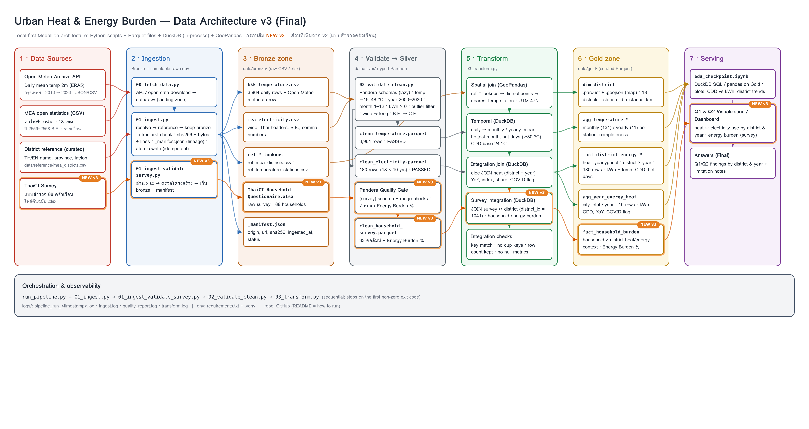

# Urban Heat & Energy Burden (CS341 Term Project)

ระบบ Data Pipeline แบบอัตโนมัติ (Local-first Medallion Architecture) สำหรับวิเคราะห์ความสัมพันธ์ระหว่างความร้อนในเมือง ลักษณะทางกายภาพของที่อยู่อาศัย และภาระค่าใช้จ่ายด้านพลังงานของครัวเรือนในกรุงเทพมหานคร (Final Version)

## สถาปัตยกรรมระบบ (Data Architecture v3)


## โครงสร้างโฟลเดอร์ (Project Structure)
* `data/bronze/` : เก็บข้อมูลดิบ (Raw Data) จาก Open-Meteo API, การไฟฟ้านครหลวง (MEA) และแบบสำรวจครัวเรือนโครงการ ThaiCI (88 ครัวเรือน เขตหลักสี่) พร้อมไฟล์ `_manifest.json`
* `data/silver/` : เก็บข้อมูลที่ผ่านการทำความสะอาด สร้างตัวแปรใหม่ (`summer_energy_burden_pct`) และตรวจสอบคุณภาพด้วย Pandera ในรูปแบบ `Apache Parquet`
* `data/gold/` : เก็บตารางวิเคราะห์เชิงลึก (Star Schema) ที่เชื่อมโยงข้อมูลระดับเขตและระดับครัวเรือนผ่านรหัสเขตหลักสี่ (`district_id = 1041`)
* `scripts/` : โค้ดสคริปต์ Python ของท่อส่งข้อมูลทั้งหมด
* `docs/` : เอกสารพจนานุกรมข้อมูล (`ThaiCI_Household_Questionaire.docx`) และแผนภาพสถาปัตยกรรมระบบ (`architecture_v3.png`)
* `notebooks/` : ไฟล์ Jupyter Notebook สำหรับสำรวจข้อมูล (EDA) และสร้างกราฟสรุปผล Q1–Q2
* `requirements.txt` : รายชื่อ Library ที่ต้องใช้ในโปรเจกต์

## วิธีการติดตั้ง (Installation)

1. **Clone Repository**
   ```bash
   git clone https://github.com/chaloemwong109-lab/urban-heat-energy-burden.git
   cd urban-heat-energy-burden
   ```

2. **สร้างและเปิดใช้งาน Virtual Environment**
   * **สำหรับ Windows:**
     ```bash
     python -m venv venv
     venv\Scripts\activate
     ```
   * **สำหรับ Mac / Linux:**
     ```bash
     python3 -m venv venv
     source venv/bin/activate
     ```

3. **ติดตั้ง Library ที่จำเป็น**
   ```bash
   pip install -r requirements.txt
   ```

## วิธีการรัน Data Pipeline (End-to-End Reproducibility)
รันคำสั่งเดียวเพื่อประมวลผลข้อมูลทั้งหมดตั้งแต่ Bronze จนถึง Gold Zone:
```bash
python scripts/run_pipeline.py
```

ระบบจะทำงานตามลำดับดังนี้:
1. `scripts/01_ingest.py` : ดึงข้อมูลสภาพอากาศ (Open-Meteo) และค่าไฟฟ้า กฟน. (MEA) เข้าสู่ Bronze Zone
2. `scripts/01_ingest_validate_survey.py` : นำเข้าแบบสำรวจครัวเรือน ThaiCI (88 ครัวเรือน) คำนวณ `summer_energy_burden_pct` และตรวจสอบคุณภาพผ่าน Pandera Quality Gate ลงสู่ `data/silver/clean_household_survey.parquet`
3. `scripts/02_validate_clean.py` : ทำความสะอาดและตรวจสอบคุณภาพข้อมูลสภาพอากาศและค่าไฟฟ้าลงสู่ Silver Zone
4. `scripts/03_transform.py` : ทำ Spatial/Temporal Join คำนวณค่า CDD และสร้างตาราง Fact/Dimension (Star Schema) ลงใน Gold Zone

## การดูผลลัพธ์และ Visualization (Q1 & Q2)
1. เปิดไฟล์ Jupyter Notebook ในโฟลเดอร์ `notebooks/` ผ่าน VS Code หรือ Jupyter Notebook
2. เลือก Kernel เป็น `venv` ที่สร้างไว้
3. กดรันทุก Cell เพื่อดู Data Schema ของชั้น Gold และกราฟวิเคราะห์ความสัมพันธ์ระหว่างลักษณะทางกายภาพของที่อยู่อาศัย ความร้อน และภาระค่าใช้จ่ายด้านพลังงานของครัวเรือน