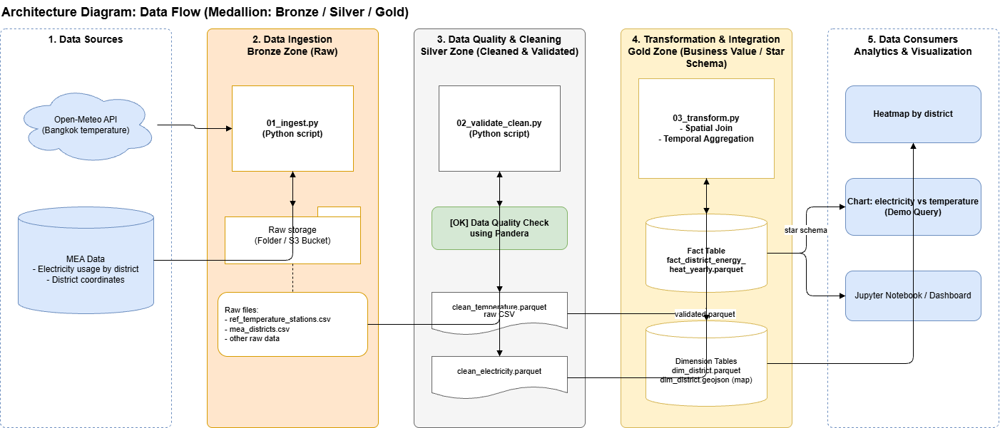

# Urban Heat & Energy Burden (CS341 Term Project)

ระบบ Data Pipeline สำหรับวิเคราะห์ความสัมพันธ์ระหว่างความร้อนและภาระค่าใช้จ่ายด้านพลังงานของครัวเรือนในเขตเมือง (สำหรับส่งงานเฟส 2: Checkpoint - Working Critical-Path Pipeline)

## 📂 โครงสร้างโฟลเดอร์ (Project Structure)
โปรเจกต์นี้ใช้การจัดเก็บข้อมูลแบบ Medallion Architecture เพื่อให้ง่ายต่อการประมวลผลแบบ Local:

* `data/bronze/` : เก็บข้อมูลดิบ (Raw Data) ที่ดึงมาจากแหล่งต้นทาง
* `data/silver/` : เก็บข้อมูลที่ผ่านการทำความสะอาดและตรวจสอบคุณภาพ (Validated & Cleaned)
* `data/gold/` : เก็บข้อมูลที่ผ่านการ Join และพร้อมนำไปใช้วิเคราะห์ (Curated Data)
* `scripts/` : โฟลเดอร์สำหรับเก็บไฟล์สคริปต์ Python (`.py`) ของ Data Pipeline
* `notebooks/` : โฟลเดอร์สำหรับเก็บไฟล์ Jupyter Notebook สำหรับทำ EDA และสรุปผล
* `requirements.txt` : รายชื่อ Library ที่ต้องใช้ในโปรเจกต์

## 🚀 วิธีการติดตั้ง (Installation)

เพื่อให้ทุกคนในทีมมี Environment ที่ตรงกัน รบกวนทำตามขั้นตอนนี้:

1. **Clone Repository** มาที่เครื่องตัวเอง
   ```bash
   git clone [https://github.com/chaloemwong109-lab/urban-heat-energy-burden.git](https://github.com/chaloemwong109-lab/urban-heat-energy-burden.git)
   cd urban-heat-energy-burden

2. **สร้างและเปิดใช้งาน Virtual Environment**
   * **สำหรับ Windows:**
     ```bash
     python -m venv venv
     venv\Scripts\activate
     ```
   * **สำหรับ Mac / Linux:**
     ```bash
     python3 -m venv venv
     source venv/bin/activate
     ```

3. **ติดตั้ง Library ที่จำเป็น**
   ```bash
   pip install -r requirements.txt

## ⚙️ วิธีการรัน Data Pipeline

โปรเจกต์นี้ออกแบบมาให้รัน Pipeline แบบ End-to-End (ตั้งแต่ดึงข้อมูลจนจบที่ Gold Zone) ผ่านคำสั่งเดียว:

```bash
python run_pipeline.py
  ```
ระบบจะทำงานตามลำดับดังนี้:

Ingestion (01_ingest.py): ดึงข้อมูลอุณหภูมิและข้อมูลการใช้ไฟฟ้าเข้าสู่ Bronze Zone

Validation & Cleaning (02_validate_clean.py): ตรวจสอบคุณภาพข้อมูล (Data Quality) ด้วย Pandera และบันทึกลง Silver Zone

Transformation (03_transform.py): ทำ Spatial/Temporal Join, คำนวณค่า CDD และสร้างตาราง Fact/Dimension (Star Schema) ลงใน Gold Zone

## การดูผลลัพธ์และ Demo (Checkpoint 2)
สำหรับการดูผลลัพธ์ของข้อมูลที่พร้อมใช้งาน และกราฟความสัมพันธ์เพื่อตอบคำถาม Proposal:

เปิดไฟล์ demo_checkpoint.ipynb ผ่าน VS Code หรือ Jupyter Notebook

เลือก Kernel เป็น venv ที่เราสร้างไว้

กดรันทุก Cell เพื่อดู Data Schema ของ Gold Zone และดูกราฟ Scatter Plot แสดงความสัมพันธ์ระหว่าง อุณหภูมิความร้อนสะสม (CDD) กับ ปริมาณการใช้ไฟฟ้า (Million kWh)

## Architecture Diagram (Data Flow)

แผนภาพแสดงสถาปัตยกรรมและการไหลของข้อมูล (Data Flow) ในระบบปัจจุบัน ตั้งแต่ Data Sources จนถึงส่วน Analytics:


